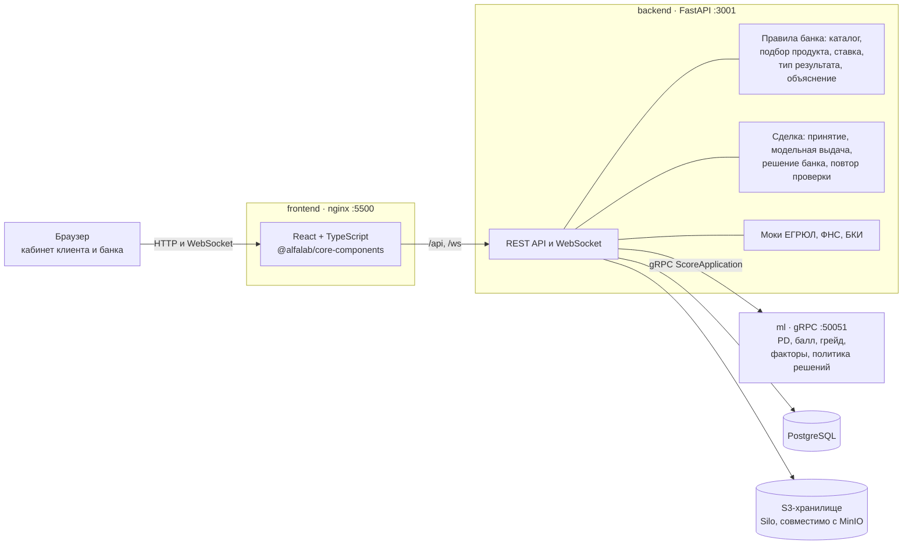

# SimpleCredits — умный кредитный кабинет предпринимателя

Прототип цифрового кредитного конвейера для малого и микробизнеса. Альфа-Хак 2026 «Альфа Будущее», трек «Умный кредитный кабинет предпринимателя», команда МИСИС.

Клиент заполняет профиль компании один раз, подаёт заявку и сразу видит решение: банк проверяет компанию в ЕГРЮЛ, ФНС и БКИ, ML-модель оценивает риск, правила банка подбирают продукт и считают условия. Дальше клиент принимает предложение и оформляет кредит — до номера модельного договора. Банк видит все заявки, оценку модели и решает заявки, которые модель отправила на ручную проверку. Статус заявки обновляется в реальном времени.

**Все данные синтетические.** Внешние источники (ЕГРЮЛ, ФНС, БКИ) — моки внутри бэкенда, модель обучена на синтетике, доступа к ресурсам банка нет. Только бесплатные компоненты с открытыми лицензиями.

## Быстрый старт

Нужен Docker с Compose.

```bash
cp .env.example .env
docker compose up -d --build
```

Первая сборка дольше обычной: при сборке образа `ml` модель обучается на синтетических данных. Когда все контейнеры поднялись:

| Что | Адрес |
|---|---|
| Кабинет (клиент и банк) | http://localhost:5500 |
| API бэкенда, Swagger | http://localhost:3001/docs |
| Консоль S3-хранилища | http://localhost:9001 (`minioadmin` / `minioadmin`) |

Значения в `.env.example` подходят для локального запуска как есть. Бэкенд при старте создаёт таблицы, каталог продуктов и администратора, а в существующую базу сам добавляет новые колонки.

## Демо-аккаунты

На экране входа — кнопки «Войти» для каждого аккаунта. При первом входе аккаунт регистрируется и получает синтетический профиль компании. ИНН подобраны так, что ответы мок-ЕГРЮЛ и мок-БКИ ведут к нужному сценарию.

| Аккаунт | Email / пароль | Сценарий |
|---|---|---|
| A · ИП Компания 9986 | `company-a@demo.simplecredits.ru` / `demo-a-2026` | Стабильный бизнес → одобрено → принять → оформить, номер договора |
| B · ООО Компания 2785 | `company-b@demo.simplecredits.ru` / `demo-b-2026` | Сумма больше 60% годовой выручки → банк предлагает 15 млн вместо 20 |
| C · ООО Компания 7752 | `company-c@demo.simplecredits.ru` / `demo-c-2026` | Риск в пограничной зоне → ручная проверка, решение принимает сотрудник банка |
| D · ИП Компания 7622 | `company-d@demo.simplecredits.ru` / `demo-d-2026` | Продукт не выбран → банк сам подбирает лизинг |
| E · ООО Компания 1178 | `company-e@demo.simplecredits.ru` / `demo-e-2026` | Текущая просрочка в БКИ → отказ с причиной и советами |
| Банк · администратор | `admin@admin.com` / `admin` | Все заявки, «Ждут проверки», решение по ручной проверке, статистика, модель |

Можно и зарегистрироваться самому: профиль заполняется по ИНН из ЕГРЮЛ, кредитная история приходит из БКИ, финансы вводятся руками.

## Ключевой сценарий за 5 минут

1. Войдите как **A** → «Новая заявка» → «Отправить заявку». Трекер проходит этапы «Заявка отправлена → Данные получены → Оценка завершена → Решение готово».
2. На карточке — «Заявка одобрена», условия (ставка по оценке риска, платёж, переплата), «Что если?» и «Что повлияло на решение». Нажмите «Принять предложение», затем «Подтвердить и оформить» — появится номер модельного договора `SC-…`.
3. Войдите как **C** и подайте заявку — «Нужна дополнительная проверка», принять нечего.
4. Войдите как **Банк** → «Ждут проверки» → заявка C → «Одобрить с другой суммой», комментарий → «Сохранить решение».
5. Снова войдите как **C** — решение банка с комментарием и кнопка «Принять предложение».

Сбой ML: `docker compose stop ml`, подайте заявку — она сохраняется со статусом «Проверка не завершилась». `docker compose start ml` → «Повторить проверку» в той же карточке.

Все сценарии с ожидаемым результатом — [docs/test-scenarios.md](docs/test-scenarios.md).

## Архитектура



- **Фронтенд** — один кабинет с двумя ролями: клиент (`user`) и банк (`admin`). nginx отдаёт статику и проксирует `/api` и WebSocket на бэкенд.
- **Бэкенд** хранит пользователей, профили, заявки и журнал событий, обогащает заявку данными ЕГРЮЛ/ФНС/БКИ, вызывает ML по gRPC и поверх ответа модели применяет правила банка: какой продукт подходит, какой подобрать, какая ставка внутри диапазона продукта, что показать клиенту.
- **ML-сервис** считает вероятность дефолта, балл, грейд, топ факторов и решение политики (одобрить / одобрить с условием / ручная проверка / отказ).

Подробно — [docs/architecture.md](docs/architecture.md): поток заявки, модель данных, состояния заявки.

## Как банк принимает решение

1. **Каталог.** Пять продуктов: микрозайм, оборотный кредит, овердрафт, кредитная линия, лизинг. У каждого — сегмент, суммы, сроки, цели, диапазон ставок, допустимые формы компании и минимальный возраст. Сегмент (микро или малый бизнес по 209-ФЗ) определяет банк по профилю.
2. **Подбор.** Если клиент не выбрал продукт, банк берёт подходящий с самой низкой ставкой. Если ни один не подходит — отказ с причиной.
3. **Оценка риска** — ML-модель: PD, грейд A–E, факторы, решение политики.
4. **Исход.** Одобрение на запрошенных условиях, другой продукт, другие условия (меньшая сумма) или ручная проверка. Ставка — внутри диапазона продукта по грейду: A — нижняя граница, E — верхняя; платёж аннуитетный.
5. **Объяснение.** Клиент видит категорию риска, главные причины, факторы, посчитанные по данным заявки, и советы «что делать дальше». Балл, PD, грейд и все факторы модели — только банку.
6. **Сделка.** Принять предложение → подтвердить и оформить → модельный договор. Выдача синтетическая: реальных денег и документов нет.

## Документация

| Что | Где |
|---|---|
| Путь пользователя, сущности, статусы, API, WebSocket, моки | [USERFLOW.md](USERFLOW.md) |
| Архитектура, поток заявки, модель данных, диаграмма состояний | [docs/architecture.md](docs/architecture.md) |
| OpenAPI | [backend/webdoc.yaml](backend/webdoc.yaml), Swagger на http://localhost:3001/docs |
| Тестовые сценарии и автотесты | [docs/test-scenarios.md](docs/test-scenarios.md) |
| Бэкенд: запуск, эндпоинты, переменные | [backend/README.md](backend/README.md) |
| Фронтенд: экраны, работа с API, тестирование | [frontend/README.md](frontend/README.md), [frontend/docs/](frontend/docs) |
| ML: данные, признаки, модели, политика, gRPC | [ml/README.md](ml/README.md), [docs/data_pipeline.md](docs/data_pipeline.md), [docs/mlflow.md](docs/mlflow.md) |
| Сторонние компоненты и лицензии | [THIRD_PARTY_NOTICES.md](THIRD_PARTY_NOTICES.md) |

## Тесты

```bash
# бэкенд: unit, integration, e2e на SQLite в памяти — внешние сервисы не нужны
cd backend && uv sync && uv run pytest

# фронтенд: юнит-тесты без бэкенда
cd frontend && npm ci && npm test

# фронтенд: e2e в браузере против поднятого docker compose (http://localhost:5500)
cd frontend && npx playwright install chromium && npm run test:e2e

# ML
cd ml && pip install -e ".[dev]" && pytest
```

Что покрыто — [docs/test-scenarios.md](docs/test-scenarios.md).

## Ограничения кейса

| Ограничение | Как соблюдено |
|---|---|
| Только веб-интерфейс | Один веб-кабинет, адаптивная вёрстка |
| Весь сценарий внутри продукта | Решение, принятие, выдача и решение банка — в кабинете; статус по WebSocket. Почты, SMS и звонков нет |
| Без платных ресурсов | Только открытые библиотеки и образы, см. [THIRD_PARTY_NOTICES.md](THIRD_PARTY_NOTICES.md) |
| Синтетические данные | Демо-профили, моки ЕГРЮЛ/ФНС/БКИ и обучающая выборка ML — синтетические |
| Автономность | Всё поднимается одной командой `docker compose up`; в работе нет запросов во внешние сервисы, шрифты и библиотеки — локально |
| LLM только с открытыми весами | LLM не используется: объяснения строятся шаблонами по кодам причин |

## Структура репозитория

```
backend/    FastAPI: API, WebSocket, правила банка, моки, клиент gRPC, тесты
frontend/   React + TypeScript: кабинет клиента и банка, юнит- и e2e-тесты
ml/         скоринговая модель и gRPC-сервис
proto/      общий gRPC-контракт backend ↔ ml
tools/      генератор сырых синтетических данных для обучения
data/       сырые синтетические данные
examples/   примеры заявок для скоринга
docs/       архитектура, тестовые сценарии, материалы кейса, пайплайн данных ML
```
