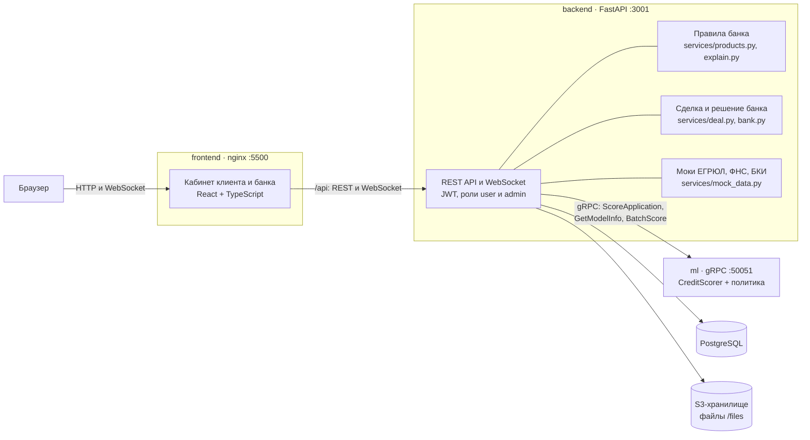
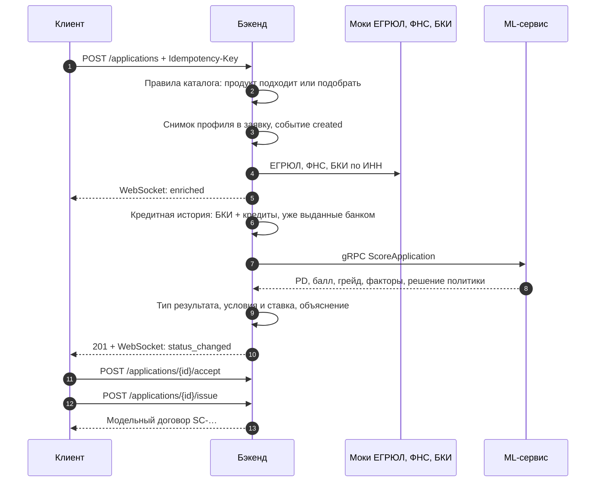
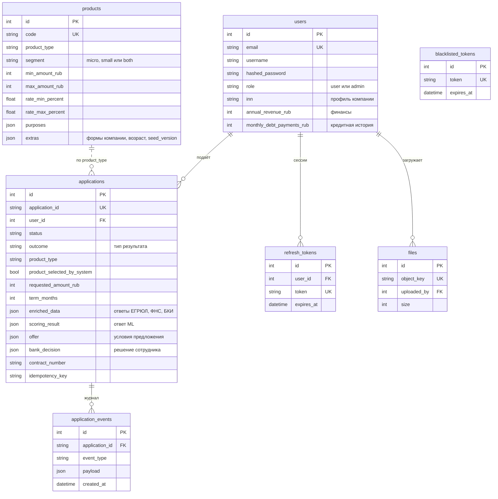
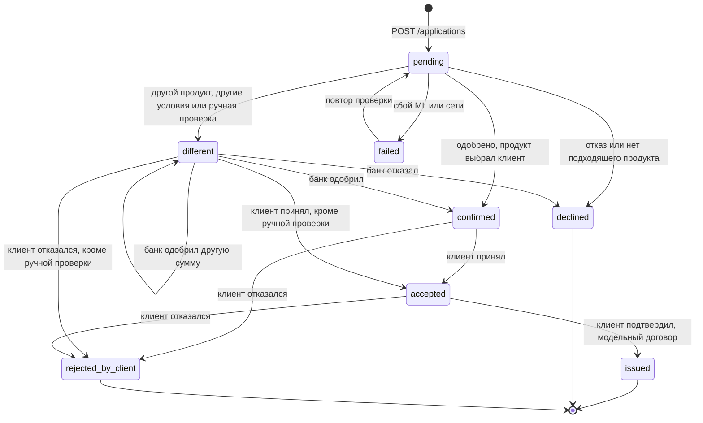

# Архитектура SimpleCredits

Короткий обзор — в [README](../README.md). Здесь: компоненты, поток заявки, модель данных, состояния заявки и ключевые решения. Допущения, упрощения и обоснования — [assumptions.md](assumptions.md). Полный контракт API — [backend/webdoc.yaml](../backend/webdoc.yaml) и [USERFLOW.md](../USERFLOW.md).

## Компоненты

| Компонент | Технологии | Что делает |
|---|---|---|
| `frontend` | React 18, TypeScript, Vite, zustand, @alfalab/core-components, nginx | Кабинет клиента (профиль, каталог, заявка, карточка заявки, принятие и оформление) и кабинет банка (все заявки, статистика, решение по ручной проверке). nginx отдаёт статику и проксирует `/api` и WebSocket |
| `backend` | FastAPI, SQLAlchemy async, Pydantic, gRPC, aiobotocore | Пользователи и профили, заявки и журнал событий, моки госисточников, правила каталога и условия предложения, сделка, решение банка, WebSocket |
| `ml` | scikit-learn, CatBoost, gRPC | PD, балл 0–1000, грейд A–E, топ-5 факторов, решение политики. Модель обучается при сборке образа на синтетических данных |
| `db` | PostgreSQL 17 | Все данные приложения |
| `minio` | Silo (S3, совместим с MinIO) | Файлы пользователей (`/files`) |

## Поток заявки

Если ML не ответил, заявка уже сохранена: бэкенд ставит статус `failed`, пишет событие и отвечает 502/504 с номером заявки. Клиент повторяет проверку той же заявки — `POST /applications/{id}/retry`.

Если модель отправила заявку на ручную проверку, решение принимает сотрудник банка: `POST /admin/applications/{id}/decision` — одобрить, одобрить с другой суммой или отказать. Клиент видит решение и комментарий в карточке.

## Правила банка поверх модели

Модель не знает каталога, поэтому продукт и условия решает бэкенд (`backend/services/products.py`, `services/application.py`):

| Шаг | Правило |
|---|---|
| Сегмент | Микробизнес — до 15 сотрудников и до 120 млн ₽ выручки в год (209-ФЗ), иначе малый |
| Подходит ли продукт | Сегмент, цель, сумма, срок, форма компании, минимальный возраст компании |
| Подбор | Клиент не выбрал продукт — из подходящих берётся продукт с самой низкой ставкой. Ни один не подошёл — отказ `NO_SUITABLE_PRODUCT` |
| Ставка | Внутри диапазона продукта по грейду: A — нижняя граница, B — 25%, C — середина, D — 75%, E — верхняя |
| Платёж | Аннуитетный; в предложении — платёж, всего выплатить и переплата |
| Модель просит снизить сумму | Тот же продукт на меньшую сумму (`COUNTER_OFFER`); если он на неё не выдаётся — другой продукт (`ALTERNATIVE_PRODUCT`); не подошёл ни один — ручная проверка |
| Объяснение | Шаблоны по кодам причин; клиенту — без балла, PD и грейда |

## Модель данных

- **Профиль** (реквизиты, финансы, кредитная история) хранится в `users`. При подаче его **снимок** копируется в заявку: заявка не меняется, если клиент потом обновит профиль. Кредитная история в снимке заменяется ответом БКИ, к ней добавляются кредиты, которые банк уже выдал этому клиенту (сводка — `enriched_data.bank_credits`).
- **Журнал** `application_events`: `created`, `enriched`, `scored`, `status_changed`, `failed`, `retry_started`, `bank_decision`, `offer_accepted`, `issued`, `offer_rejected`. По нему строится трекер и история в карточке.
- **Уникальность**: `(user_id, idempotency_key)` в `applications` — повтор запроса с тем же ключом возвращает ту же заявку.
- **Миграции**: таблицы создаются при старте; в существующую базу бэкенд добавляет недостающие колонки и индексы (`backend/database.py`). Каталог обновляется по `SEED_VERSION`.

Поля перечислены не все — полный список в `backend/models/` и в [USERFLOW.md](../USERFLOW.md) §3.

## Состояния заявки

`different` уточняет поле `outcome`: `ALTERNATIVE_PRODUCT` (другой продукт или подобранный банком), `COUNTER_OFFER` (тот же продукт на другую сумму), `MANUAL_REVIEW` (ждёт решения банка — это не предложение). Какие действия доступны клиенту сейчас, бэкенд присылает в поле `actions`: `accept`, `reject`, `issue`, `retry`.

## Ключевые решения

- **Статусы совместимы с исходным USERFLOW.** Пять исходных статусов остались, `different` уточняется `outcome`, для сделки добавлены `accepted`, `issued`, `rejected_by_client`.
- **Модель и правила банка разделены.** ML оценивает риск, бэкенд решает про продукт и условия. Правила детерминированы и покрыты тестами.
- **Смена статуса — один условный UPDATE.** Два одновременных «принять» или «повторить» не пройдут оба.
- **Клиенту — только то, что ему нужно.** В WebSocket и на экране клиента нет балла, PD и грейда; у банка — полный результат модели.
- **Выдача модельная.** Номер договора и событие в журнале; реальных проводок и документооборота нет.
- **Доступ.** Клиент видит только свои заявки и файлы; кабинет банка, список пользователей и решения по заявкам — только роль `admin`. После выхода токен попадает в чёрный список, в том числе для WebSocket.
