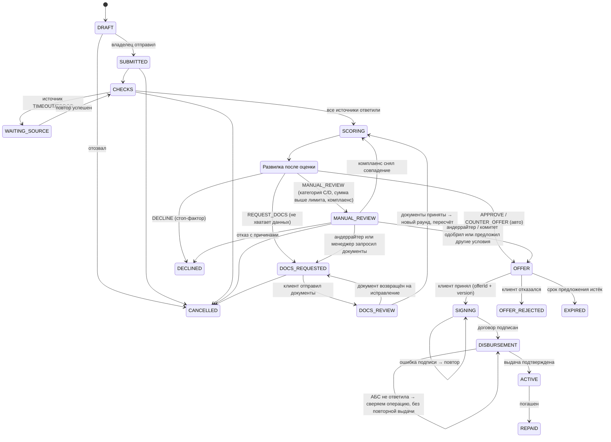

# Статусы заявки

`REQUEST_DOCS`, `MANUAL_REVIEW` и `WAITING_SOURCE` — промежуточные состояния, не отказ. Клиент видит их как «Нужен документ», «Дополнительная проверка» и «Ждём источник» без риск-балла.

Трекер клиента (6 этапов): Отправлена → Проверка данных → Оценка → Решение → Подписание → Выдача.
