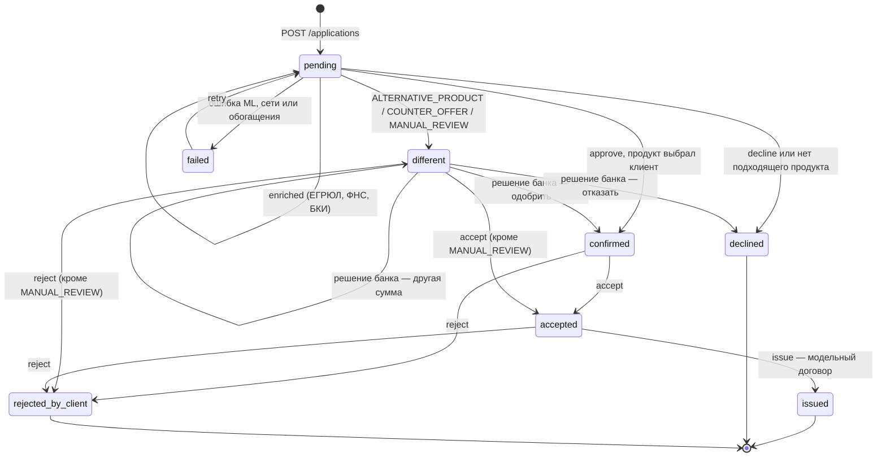

# Статусы заявки

По `USERFLOW.md` §5 и `backend/services/`.

`different` — не отказ, его уточняет `outcome`:

- `ALTERNATIVE_PRODUCT` — банк предлагает другой продукт или подобрал продукт сам (клиент не выбирал);
- `COUNTER_OFFER` — тот же продукт на другую сумму;
- `MANUAL_REVIEW` — заявку смотрит сотрудник банка. Это не оффер: принять нечего, пока банк не решит.

События заявки (`GET /applications/{id}/events`): `created` → `enriched` → `scored` → `status_changed` (или `failed`), затем `retry_started`, `bank_decision`, `offer_accepted`, `issued`, `offer_rejected`. По ним строится трекер: «Заявка отправлена → Данные получены → Оценка завершена → Решение готово → Предложение принято → Кредит выдан».

Выдача модельная: номер договора и запись в журнале, реальных проводок и документооборота нет.
