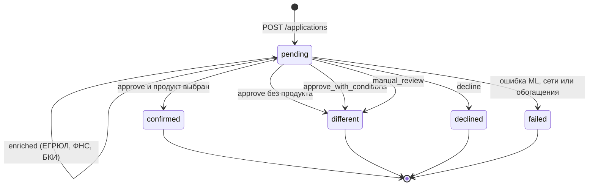

# Статусы заявки

По `USERFLOW.md` §5 и `backend/services/scoring.py`.

`different` — не отказ: банк одобряет на других условиях, подобрал продукт сам или заявке нужна ручная проверка. Какой именно случай, фронтенд определяет по `scoring_result.decision.decision`.

События заявки (`GET /applications/{id}/events`): `created` → `enriched` → `scored` → `status_changed` (или `failed`). По ним строится трекер: «Заявка создана → ЕГРЮЛ, ФНС, БКИ → Скоринг → Решение».

Дальнейших этапов (подписание, выдача, сопровождение) в MVP нет — путь заканчивается на статусе.
